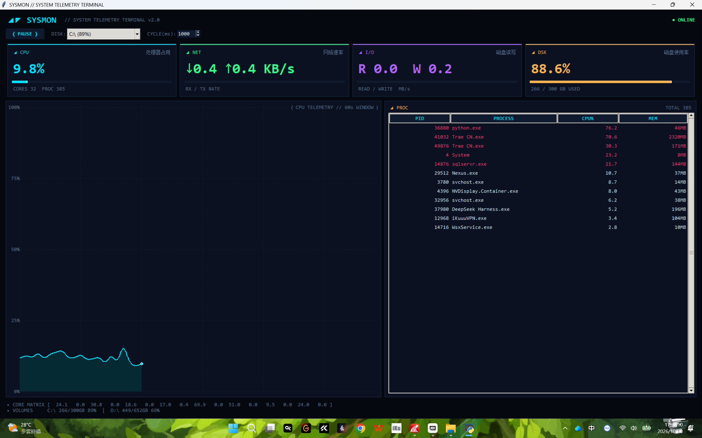
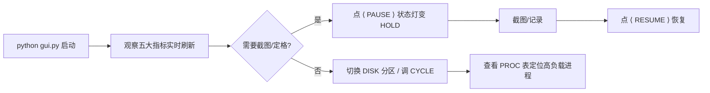
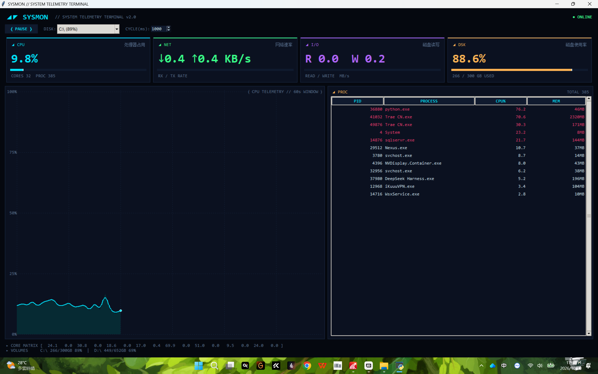

# ◢◤ SYSMON 系统遥测终端 —— 操作手册

> **版本**：v2.0（科幻版）  **更新**：2026-10-30  **代码库**：https://github.com/klsjSDE6/SystemMonitor

---

## 一、项目概述

基于 **Python + psutil + Tkinter** 实现的科幻风桌面系统监控终端，覆盖五大监控指标：

| # | 指标 | 说明 | psutil API |
| --- | --- | --- | --- |
| 1 | CPU 占用率 | 整体 + 每核心实时占用，60 秒遥测折线图 | `cpu_percent(percpu=True)` |
| 2 | 网络收发速率 | 实时上行/下行速率，单位自动换算 | `net_io_counters()` 差值 ÷ 间隔 |
| 3 | 磁盘 IO 读写速率 | 读/写速率 MB/s + 进度条 | `disk_io_counters()` 差值 ÷ 间隔 |
| 4 | 磁盘使用率 | 各分区容量、已用、使用率，可切换 | `disk_partitions()` + `disk_usage()` |
| 5 | **进程信息** | 进程总数 + TOP 12 进程（PID/名称/CPU%/内存） | `process_iter()` + `cpu_percent()` / `memory_percent()` / `memory_info()` |

### 技术栈

```
Python ≥ 3.8  ·  psutil ≥ 5.9.0（系统采集）  ·  Tkinter + tk.Canvas（GUI，零第三方绘图库）
```

### v2.0 科幻风特性

- 🛰️ **深空配色**：`#05080f` 深空黑底 + 霓虹青/绿/紫/琥珀四色数据通道
- 📟 **终端字体**：全界面等宽 Consolas + 角标装饰符 `◢ ⟨ ⟩ ▸ │`
- ✨ **拟发光动效**：折线图末端光点、进度条末端亮斑
- 🚨 **进程告警**：CPU ≥ 20% 的进程红色高亮；状态灯 ONLINE(绿) / HOLD(红)

---

## 二、环境要求

| 项目 | 要求 |
| --- | --- |
| 操作系统 | Windows 10/11、macOS 12+、Linux 主流发行版 |
| Python | 3.8 ~ 3.12 |
| 依赖 | 仅 `psutil` |
| 屏幕 | 最低 1024×768（推荐 1920×1080 以上，程序最大化展示效果最佳） |

Windows 未装 Python：到 [python.org](https://www.python.org/downloads/) 下载安装，**勾选 Add Python to PATH**。

---

## 三、安装与启动（3 步）

```bash
# 1. 克隆（或 GitHub 页面 Code → Download ZIP 解压）
git clone https://github.com/klsjSDE6/SystemMonitor.git
cd SystemMonitor

# 2. 安装依赖（国内慢可加 -i https://pypi.tuna.tsinghua.edu.cn/simple）
pip install -r requirements.txt

# 3. 启动
python gui.py
```

启动后弹出标题为 **「SYSMON // SYSTEM TELEMETRY TERMINAL」** 的深色窗口，约 1 秒后数据开始滚动。

---

## 四、界面详解


▲ 全屏运行实况（2560×1600 物理像素截图）

### 4.1 顶部区域（左 → 右）

| 控件 | 功能 |
| --- | --- |
| `◢◤ SYSMON // SYSTEM TELEMETRY TERMINAL v2.0` | 终端标题 |
| `● ONLINE` / `◌ HOLD` | **状态灯**：绿色=实时刷新中，红色=已暂停 |
| `⟨ PAUSE ⟩` / `⟨ RESUME ⟩` | 暂停/恢复按钮 |
| `DISK:` 下拉框 | 磁盘分区切换（默认系统盘） |
| `CYCLE(ms):` 输入框 | 采样周期，200~10000ms，默认 1000 |

### 4.2 四大指标面板（霓虹色通道）

| 面板 | 颜色 | 内容 |
| --- | --- | --- |
| ◢ CPU 处理器占用 | 霓虹青 `#00e5ff` | 整体 % 大数值 + 进度条 + 核心数/进程总数 |
| ◢ NET 网络速率 | 霓虹绿 `#39ff88` | ↓接收 ↑发送（KB/s、MB/s 自动换算）+ 量程进度条 |
| ◢ I/O 磁盘读写 | 霓虹紫 `#b366ff` | R 读 / W 写速率（MB/s）+ 量程进度条 |
| ◢ DSK 磁盘使用率 | 琥珀 `#ffb454` | 使用率 % + 已用/总量 GB + 进度条 |

### 4.3 左下：CPU 遥测折线图

- 横轴为最近 **60 秒**时间窗，纵轴 0~100%
- 霓虹青折线 + 暗青渐变填充 + **末端光点**跟随最新值
- 虚线网格：横向每 25%、纵向每 10 秒
- 暂停时曲线冻结

### 4.4 右下：◢ PROC 进程监控表 ⭐新增

| 列 | 说明 |
| --- | --- |
| `PID` | 进程 ID |
| `PROCESS` | 进程名（超长截断到 24 字符） |
| `CPU%` | 该进程自上次采样以来的 CPU 占用率 |
| `MEM` | 常驻内存（MB） |

- 右上角 `TOTAL xxx` 显示当前进程总数
- 按 **CPU 占用降序**取 TOP 12
- **CPU ≥ 20% 的进程整行红色高亮**（快速定位"吃 CPU 大户"）
- 已自动剔除无意义的 `System Idle Process`（PID 0）

### 4.5 底部状态行

- `▸ CORE MATRIX`：每核心 CPU 占用百分比阵列
- `▸ VOLUMES`：所有磁盘分区的容量/使用率一览

---

## 五、操作指南

### 5.1 基本流程



### 5.2 暂停 / 恢复

点击 `⟨ PAUSE ⟩`：所有面板、折线图、进程表定格在最后一帧；状态灯变红 `◌ HOLD`；按钮变为 `⟨ RESUME ⟩`。


▲ 暂停状态：数据定格，状态灯转红

### 5.3 采样周期参考

| 周期 | 场景 | 自身 CPU 占用 |
| --- | --- | --- |
| 200~500ms | 捕捉瞬时峰值 | 略高（进程遍历较频繁） |
| **1000ms（默认）** | 日常监控 | 低 |
| 2000~5000ms | 低配机器/挂机 | 极低 |

> ⚠️ 进程表遍历全系统进程，采样周期越小开销越大；低配机器建议 ≥1000ms。

### 5.4 用进程表排查卡顿

1. 感觉电脑卡 → 看 ◢ PROC 表
2. 红色高亮行 = CPU ≥ 20% 的进程
3. 对照 PID 在任务管理器中确认/结束对应进程

---

## 六、作业要求对应表

| 作业要求 | 实现位置 |
| --- | --- |
| ① 图形用户界面 | `gui.py`（科幻终端风：面板 + 折线图 + 进程表） |
| ② 代码提交 GitHub | https://github.com/klsjSDE6/SystemMonitor （main 分支） |
| ③ 系统文档 | 本手册 + `README.md`（框架/技术、功能、手册、仓库地址） |
| ④ 源码+文档压缩提交 | `SystemMonitor_submit.zip`（含源码、文档、全屏截图） |

## 七、psutil API 对照表（核心知识点）

```python
psutil.cpu_percent(interval=None, percpu=True)   # 整体+每核心 CPU%
psutil.net_io_counters()                         # 网络累计字节（差值算速率）
psutil.disk_io_counters()                        # 磁盘累计读写（差值算速率）
psutil.disk_partitions(all=False)                # 已挂载分区
psutil.disk_usage(mountpoint)                    # 分区容量/使用率
psutil.process_iter()                            # 遍历进程
proc.cpu_percent(None)                           # 进程 CPU%（需先预热一次）
proc.memory_percent() / proc.memory_info().rss   # 进程内存占比 / 常驻内存
```

## 八、常见问题

| 问题 | 解决 |
| --- | --- |
| `No module named 'psutil'` | `pip install psutil` |
| 启动闪退/空白 | 确认 Python ≥ 3.8；重装时勾选 tcl/tk |
| 网络速率前 1~2 秒为 0 | 正常，差值算法需要两次采样 |
| 进程表某行红色 | 该进程 CPU ≥ 20%，属正常告警高亮 |
| 看不到 System Idle Process | 程序主动剔除了 PID 0（无监控意义） |
| 低配机器卡顿 | 把 CYCLE 调到 2000ms 以上 |

## 九、扩展方向

| 方向 | 难度 | 说明 |
| --- | --- | --- |
| 进程右键结束 | ⭐⭐ | Treeview 绑右键菜单调 `psutil.Process(pid).terminate()` |
| CSV 历史导出 | ⭐⭐ | 采样数据追加写 CSV，Excel 可分析 |
| 多指标折线叠加 | ⭐⭐⭐ | 网络/IO 速率也画进折线图 |
| 阈值告警音 | ⭐⭐ | CPU>90% 播放提示音 |
| PyInstaller 打包 | ⭐⭐ | `pyinstaller -F -w gui.py` 单文件 exe |

---

**仓库地址**：https://github.com/klsjSDE6/SystemMonitor
